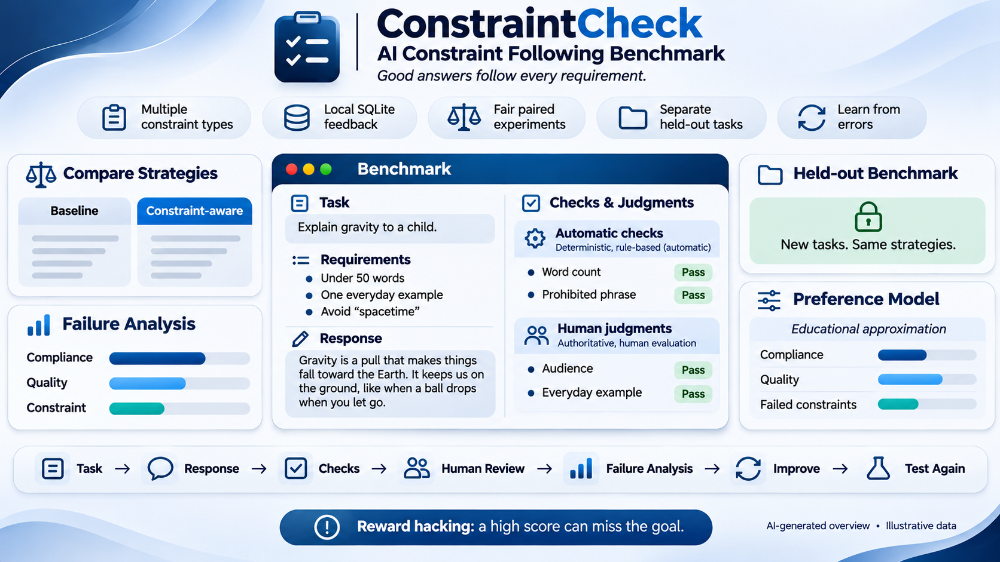

# ConstraintCheck — AI Constraint Following Benchmark

**Good answers follow every requirement.** A beginner-friendly portfolio application for evaluating instruction following, collecting human feedback, diagnosing failures, and comparing prompting strategies on new tasks.



*AI-generated illustration of the workflow, not a screenshot or measured benchmark result. The [image prompts](docs/image-generation.md) are included.*

## Overview and problem

A response can be factually correct, fluent, and still fail its task. “Explain gravity to a child in under 50 words” requires more than scientific detail: audience and length matter too. A single quality score can hide these failures.

ConstraintCheck turns each requirement into a visible check, preserves automatic evidence separately from human judgments, and explains which requirements were violated. It demonstrates AI evaluation, preference data, failure analysis, model comparison, iterative improvement, and reward-model concepts without training a language model or running production RLHF/PPO. The original specification is retained in [prompt.txt](prompt.txt).

## Features and application pages

| Page | What you can do |
| --- | --- |
| Home | Understand why instruction following matters and follow the evaluation workflow. |
| Benchmark | Select one of 20 development tasks, generate a response, inspect checks, and save feedback. |
| Custom Task Builder | Build a request with 1–10 typed constraints; start with five and add or remove requirements. |
| Side-by-Side Comparison | Run both strategies with identical inputs/settings, evaluate both, and save a preference or tie. Supports practice and custom tasks. |
| Dataset | Filter by task, strategy, model, compliance, acceptance, and violated constraint type; inspect full records and export CSV. |
| Analytics | Chart compliance by strategy, failures, acceptance, trends, and constraint-category performance. |
| Failure Analysis | Inspect examples of specific violations and partially followed instructions. |
| Constraint Difficulty | Rank types by human pass rate with counts and N/A coverage. |
| Improvement Experiment | Inspect the fixed strategies and compare matched held-out results within a generation protocol. |
| Held-Out Benchmark | Judge ten separate tasks with 3–6 constraints each and track paired outcomes. |
| Preference Model | Train a small logistic classifier from scored development comparisons; inspect accuracy and coefficients. |
| Reward Hacking | Adjust hypothetical reward weights and see why a high proxy score can miss the actual request. |
| Concepts | Learn prompts, constraints, feedback, rewards, evaluation, RLHF, and iterative improvement in context. |

The regular selector never includes the ten held-out tasks. The task library covers 16 constraint types across education, writing, workplace messages, public information, structured output, instructions, and summarization. Tasks that require source material include that material in the request.

## Architecture

```text
Task library / custom builder
             ↓
Main request + typed constraints
             ↓
Baseline or constraint-aware prompt → OpenAI Responses API
             ↓
Generated response → deterministic checker evidence
             ↓
Human Pass / Fail / N/A + quality scores + acceptance + rationale
             ↓
Validated snapshots → SQLite
             ↓
Dataset / CSV / analytics / failures / constraint difficulty
             ↓
Matched comparisons → toy preference classifier
             ↓
Separate held-out tasks → matched improvement experiment
```

Streamlit provides both the browser interface and Python application server. Business logic is separated into reusable modules. SQLite stores two tables: immutable evaluation snapshots and comparisons referencing two evaluation IDs. The JSON snapshots retain the complete task, requirements, automatic evidence, human decisions, generation settings, and rationale. Indexed fields support split/protocol checks; foreign keys connect paired records. A comparison and its two evaluations are saved in one transaction.

```text
ConstraintCheck-AI-InstructionFollowing-ConstraintBenchmark/
├── app.py
├── pages/
│   ├── 1_Benchmark.py
│   ├── 2_Custom_Task.py
│   ├── 3_Compare_Strategies.py
│   ├── 4_Dataset.py
│   ├── 5_Analytics.py
│   ├── 6_Failure_Analysis.py
│   ├── 7_Constraint_Difficulty.py
│   ├── 8_Held_Out_Test.py
│   ├── 9_Preference_Model.py
│   ├── 10_Reward_Hacking.py
│   ├── 11_Concepts.py
│   └── 12_Improvement_Experiment.py
├── src/
│   ├── __init__.py
│   ├── config.py
│   ├── openai_client.py
│   ├── generation.py
│   ├── task_library.py
│   ├── constraint_checker.py
│   ├── evaluation.py
│   ├── database.py
│   ├── analytics.py
│   ├── experiments.py
│   ├── experiment_ui.py
│   ├── preference_model.py
│   └── ui.py
├── tests/
│   ├── conftest.py
│   ├── test_config.py
│   ├── test_constraint_checker.py
│   ├── test_task_library.py
│   ├── test_evaluation.py
│   ├── test_database.py
│   ├── test_openai_client.py
│   ├── test_analytics.py
│   ├── test_preference_model.py
│   ├── test_experiments.py
│   └── test_app.py
├── data/.gitkeep
├── docs/
│   ├── image-generation.md
│   └── images/application-overview.png
├── .streamlit/config.toml
├── .env.example
├── .gitignore
├── pytest.ini
├── requirements.txt
├── prompt.txt
└── README.md
```

## Technology stack

Python 3.11+, Streamlit, the official OpenAI Python SDK, Pandas, NumPy, SQLite, Matplotlib, scikit-learn, python-dotenv, and pytest. SQLite comes with Python; charts use Matplotlib only. Development verification uses Python 3.12.6. The API integration follows the [official Responses API reference](https://developers.openai.com/api/reference/python/resources/responses/methods/create).

## Installation

Clone the repository and enter it:

```sh
git clone https://github.com/sreytouch/ConstraintCheck-AI-InstructionFollowing-ConstraintBenchmark.git
cd ConstraintCheck-AI-InstructionFollowing-ConstraintBenchmark
python -m venv venv
```

Activate on macOS/Linux:

```sh
source venv/bin/activate
```

Activate in Windows Command Prompt:

```bat
venv\Scripts\activate
```

Or in Windows PowerShell:

```powershell
.\venv\Scripts\Activate.ps1
```

Install dependencies:

```sh
pip install -r requirements.txt
```

If `python` is unavailable before activation on macOS/Linux, use `python3 -m venv venv`.

## Environment setup

Copy the example on macOS/Linux:

```sh
cp .env.example .env
```

Or in PowerShell:

```powershell
Copy-Item .env.example .env
```

Edit `.env` locally:

```dotenv
OPENAI_API_KEY=your_api_key_here
OPENAI_MODEL=gpt-4.1-mini
OPENAI_USE_TEMPERATURE=true
OPENAI_TEMPERATURE=0.7
OPENAI_MAX_OUTPUT_TOKENS=1024
CONSTRAINTCHECK_DB_PATH=data/constraintcheck.db
```

Create a key in the [OpenAI API dashboard](https://platform.openai.com/api-keys) and replace the placeholder. Never put a real key in source code, screenshots, or Git. `.env`, databases, and Streamlit secrets are ignored. The app does not display the key. Missing keys disable generation while learning pages and saved data remain accessible.

Settings are read from the project `.env`; process environment variables take priority. The model is configurable through `OPENAI_MODEL`. Set `OPENAI_USE_TEMPERATURE=false` when using a model that does not accept temperature. Temperature must be 0–2; the output budget must be an integer from 64–16384, subject to the model's own limits. Relative database paths resolve from the project folder. SQLite tables initialize automatically when data is first read or saved.

## Running the project

```sh
streamlit run app.py
```

Open the local URL printed in the terminal. Stop the server with `Ctrl+C`. This is a Python server application; pushing to GitHub does not deploy it, and GitHub Pages cannot run its backend.

## Complete evaluation workflow

1. Open **Benchmark**, choose a category and task, then select Baseline or Constraint-aware.
2. Generate a response. Read the complete request and every requirement.
3. Inspect **Automatic checks**. They provide evidence, not final subjective judgments.
4. Explicitly choose Pass, Fail, or Not Applicable for each requirement. Add optional notes; notes are required whenever you override an automatic result, including marking it N/A.
5. Score Correctness, Relevance, Clarity, and Overall Quality from 1 to 5. Sliders start at 3 as a UI default, not an AI-assigned rating.
6. Choose whether you would accept the response and explain your reasoning.
7. Save. The dataset retains the response, task snapshot, all checks and judgments, settings, timestamp, and derived score. Repeated saves do not duplicate a record.
8. Inspect failures and difficulty patterns. Use a development comparison to judge the two strategies on the same request.
9. Freeze the strategy and settings before opening held-out tasks. Judge both responses and save one preference per task/protocol.
10. Review the matched experiment metrics with coverage and sample size. Treat changes as evidence to investigate, not guaranteed general improvement.

Use **Custom Task Builder** for your own requests. Numeric and phrase descriptions are constructed from their values so the generated prompt matches the checker. Human-only requirements remain free text. “Under 25 words” means a maximum of 24, whereas “maximum 25” is inclusive. The custom task can be sent to Side-by-Side Comparison.

Save feedback before ending the session. Unsaved drafts are session-only. Changing a task, strategy, or settings after generation blocks saving that stale response until the original selection is restored or a fresh response is generated.

## Benchmark methodology and model comparison

Single-response generation uses one API call. Paired generation uses two independent calls with identical task content, model, temperature setting, and output budget; only the strategy instructions differ. Neither response sees the other. Identical responses are valid and can receive a tie. A failed second call does not expose a partial pair for saving. The SDK may retry eligible request failures once, so HTTP attempts may exceed the usual one or two calls.

Generation sends task content to OpenAI and can incur API charges. Requests use `store=False`; this does not claim that the provider retains no operational data. No live requests are made by the tests.

To compare models, set `OPENAI_MODEL` in `.env`, repeat the same development task set, and inspect the model and protocol filters in Analytics and Dataset. Generation records retain the model and settings. An ordinary strategy-average difference can reflect a different task/evaluator mix; it is not a controlled model comparison. The paired experiment intentionally keeps the model identical within each comparison.

## Automatic versus human evaluation

| Constraint types | Evaluation method |
| --- | --- |
| Maximum/minimum/exact words | Automatic word-token count, with human confirmation |
| Maximum/exact sentences | Automatic punctuation-based count, with human confirmation |
| Exact bullets | Automatic bullet-marker count, with human confirmation |
| Required/prohibited phrase | Literal phrase check, with human confirmation |
| Required/prohibited concept, tone, audience | Human judgment |
| Format, information preservation, unsupported information, output ordering | Human judgment |

The counting conventions are inspectable in `src/constraint_checker.py`:

- **Words:** Unicode letter/digit runs; internal apostrophes and hyphens stay together. Underscores and other punctuation separate tokens; punctuation alone is not a word.
- **Sentences:** runs of `.?!` followed by whitespace/end, optionally followed by closing quotes/brackets, end a sentence. A final unpunctuated fragment counts. Abbreviations may overcount and newline-only lists may undercount.
- **Bullets:** nonempty lines beginning with `-`, `*`, `+`, or `•` followed by whitespace. Numbered lists and continuation lines are not bullets; nested marked lines count too.
- **Phrases:** case-insensitive literal matching with normalized whitespace and word boundaries at alphanumeric edges. Synonyms, inflections, punctuation variants, and meaning are not inferred.

Per-bullet word limits, valid JSON, age appropriateness, truth, and politeness require human review in this release. Automatic results are recalculated from the saved snapshot during validation. The final human decision remains separately stored and determines reported compliance.

## Compliance scoring and failure analysis

```text
Compliance = passed constraints / (passed + failed constraints) × 100
```

Four passes and one failure give 80%. N/A is excluded from the denominator. An all-N/A response has **undefined compliance**, never 100%. A **full pass** requires every listed constraint to pass; even a 100% applicable score with an N/A is not a full pass.

Analytics reports macro-average compliance over responses with defined scores, plus coverage, N/A counts, acceptance, and failed-constraint counts. Type-level pass rates divide passed judgments by Pass + Fail for that type. Failure analysis maps individual failed requirements into word-count, formatting, required-content, prohibited-content, tone, audience, meaning, and unsupported-information categories. “Partial instruction following” is an overlapping response-level summary, not another failed constraint.

Acceptance is a separate human judgment. Correctness, relevance, clarity, and overall quality are also separate from compliance. A response can pass mechanical checks while failing the main request, so inspect all of these signals.

## Improvement experiment and held-out testing

The **Baseline** prompt simply asks for the requested response. **Constraint-aware** prompting explicitly asks the model to identify requirements, draft, check, revise violations, and return only the final answer. The checklist is not shown, and no claim is made that the model actually completed an internal verification procedure.

The ten held-out tasks are separate from development selectors and preference-model training. Each has 3–6 constraints. The experiment reports average compliance and its coverage, acceptance rate, full-pass response count, full-compliance rate, average quality, N/A counts, and preference/tie rates. Both arms use exactly the completed matched tasks; incomplete comparisons contribute nothing.

A protocol ID fingerprints the fixed prompt version, both strategy instructions, model, temperature setting, and token budget. Results from different protocols are not pooled on the experiment page. The database retains the first saved judgment for each held-out task ID and protocol. To change the task library or design a later experiment, use fresh tasks and new versioned task IDs and update `PROTOCOL_VERSION` in `src/generation.py` as appropriate.

Recorded reuse of a held-out main request in development excludes that task from clean results, ignoring capitalization and repeated whitespace. Stored task snapshots must match the current fixed library. This detects recorded exact-text reuse, not paraphrases or exposure outside the app. Viewing results and tuning against these examples makes them development evidence for the revised strategy, even if you change protocols.

The session retains one generated pair per held-out task/protocol, but restarting an unsaved session can regenerate it. This is not a tamper-proof benchmark. Visible strategy labels, subjective ratings, and ten tasks limit the strength of conclusions.

## Preference-model demo

The educational classifier learns from **development comparison data only**. It excludes ties and pairs with undefined compliance. Features are baseline-minus-constraint-aware differences in compliance, correctness, relevance, clarity, overall quality, and failed-constraint fraction. Compliance is scaled by 100, ratings by 5, and failed constraints by the total requirements.

At least eight distinct request-and-constraint identities are required. Tasks are grouped by a fingerprint before a reproducible 75/25 train/test split, so repeated or renamed copies stay together. Each pair is mirrored with reversed features and outcome to supply both labels. These rows are not additional human judgments. Logistic regression has no intercept, so swapping the pair reverses its estimated preference.

The page shows training comparisons, task groups, held-out accuracy, coefficients, and an inspectable saved prediction. Coefficients describe associations in human ratings, not causal importance. The model needs human scores and does not evaluate unseen response text by itself. Its internal held-out task groups are separate from the app's fixed held-out benchmark. Eight groups are a teaching minimum, not a reliable benchmark sample size.

## Reward hacking example

The interactive demo compares a 200-word technical gravity explanation with a 40-word child-friendly one for an under-50-word request. Hypothetical reward weights can favor technical detail while ignoring length and audience. Adding instruction following, length compliance, audience fit, and correctness changes that tradeoff.

Optimizing an incomplete metric can improve its score while hurting actual task completion. Conscious cheating is not required. The example illustrates this failure mode; it does not prove that a particular model learned to exploit a reward.

## Tests and verification

```sh
python -m pytest -q
python -m compileall -q app.py src pages tests
```

Tests cover deterministic counts and phrases, task-library isolation, compliance denominators, validation, SQLite initialization and atomic paired saves, malformed records, CSV export, API errors and request isolation, grouped preference-model splitting, analytics, held-out eligibility, and Streamlit interactions. API calls are mocked and guarded against accidental live requests. Tests use temporary databases and do not touch collected user feedback.

Local verification includes Streamlit startup and browser inspection. Offline tests do not verify your live API credentials, account permissions, billing, or model availability.

To publish changes after checking them:

```sh
python -m pytest -q
git diff --check
git add app.py pages src tests data/.gitkeep docs .streamlit/config.toml .env.example .gitignore pytest.ini requirements.txt README.md prompt.txt
git commit -m "Update ConstraintCheck"
git push origin main
```

## Troubleshooting

| Symptom | Action |
| --- | --- |
| Generation is disabled | Copy `.env.example` to `.env` and replace the key placeholder. |
| API authentication/model error | Check the key, configured model, API billing, and model access. |
| API rejects settings | Check token limits; disable temperature when unsupported. |
| Response is incomplete | Shorten the task or increase the output token budget within model limits. |
| Save requires a note | Explain why your judgment differs from the automatic result. |
| Save is disabled after editing | Restore the task/strategy/settings used for the response or generate anew. |
| Database cannot be read | Check the path and permissions; restore a valid backup if records were manually modified. |
| Held-out task is unavailable | Check recorded development reuse or the first-judgment rule. Use new tasks for a later experiment. |
| Preference model lacks data | Collect decisive, fully scored comparisons across at least eight distinct development tasks. |

## Limitations and future improvements

This is a local educational application without authentication or evaluator identities. It is not suitable for untrusted multi-user hosting as-is. SQLite feedback is excluded from Git; back it up separately. Do not treat an AI-generated response or an automatically passed format check as proof of factual correctness.

Counting rules are heuristics, not full linguistic analysis. Requirement descriptions can be ambiguous or mutually incompatible. Human N/A choices and overrides can affect averages. Small samples, repeated tasks, correlated ratings, model sampling, and visible labels can bias results. The toy model predicts preferences from human scores and updates no LLM weights. Task similarity and unrecorded exposure can still leak across development and test sets.

Useful next improvements are randomized/blinded response order, evaluator identities and agreement analysis, larger versioned task sets, model snapshots and reproducible run manifests, confidence intervals, stronger deterministic JSON/ordering checks, reviewed demonstration exports, and authenticated shared storage with migrations. Any prompt change should be tested on genuinely new examples.
